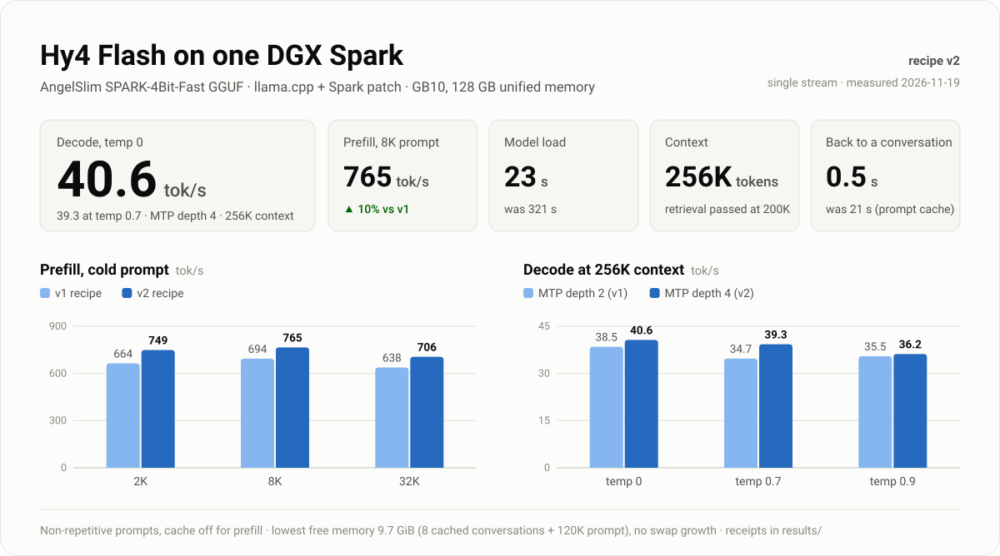

# Hy4-Flash-Spark-recipe

Serving recipe for **Hy4 Flash on one NVIDIA DGX Spark (GB10, 128 GB unified memory)**:
AngelSlim's `SPARK-4Bit-Fast` GGUF on llama.cpp with AngelSlim's Spark patch, native MTP
speculative decoding, GPU vision, and a 256K context. The 62.7 GiB Engram/PLE n-gram table
stays on the SSD and is read on demand; everything else (~87 GiB) is GPU-resident.

<picture>
  <source media="(prefers-color-scheme: dark)" srcset="assets/result-card-dark.svg">
  
</picture>

| | v1 recipe | **v2 recipe (this repo)** |
|---|---|---|
| Model load | 321 s | **23 s** |
| Prefill, cold 2K / 8K / 32K | 664 / 694 / 638 tok/s | **749 / 765 / 706 tok/s** |
| Time to first token, 32K prompt | 52.3 s | **47.2 s** |
| Decode at 256K, temp 0 / 0.7 / 0.9 | 38.5 / 34.7 / 35.5 tok/s (MTP depth 2) | **40.6 / 39.3 / 36.2 tok/s** (MTP depth 4) |
| Context | 64K | **256K** (retrieval passed at 60K, 120K and 200K) |
| Returning to a conversation after another one | ~21 s (full re-prefill) | **0.5 s** with `--cache-ram 4096` |
| Lowest free memory | 22.5 GiB | 13.1 GiB (no prompt cache) · 9.7 GiB (8 cached conversations + 120K prompt) |

Single stream, one GB10, measured 2026-11-19. Text, visible reasoning, vision and tool-call
checks passed in every configuration; no configuration grew host swap. Full method, every
configuration tried, and the prefill profile: [`TESTING-AND-RESULTS.md`](TESTING-AND-RESULTS.md).
Raw receipts: [`results/`](results/).

## Quick start

Prerequisites: a DGX Spark / GB10 with CUDA 13.0, `cmake`, `ninja`, Python 3, and ~180 GB free on
the NVMe (150 GiB of model files; the downloader keeps a 20 GiB reserve). Nothing else may be using the GPU while Hy4 runs.

```bash
HY4_BUILD_JOBS=8 bash build.sh     # llama.cpp 2cbca38 + AngelSlim Spark patch (SHA-256 pinned), SM121a
python3 download.py                # model + vision projector -> ~/models/, resumable, SHA-256 verified
python3 serve.py --cache-ram 4096  # 256K ctx, MTP depth 4, DirectIO load; listens on 127.0.0.1:8087
```

`python3 serve.py --dry-run` prints the full environment and command line without starting anything.
Smoke check (should answer 204):

```bash
curl -s 127.0.0.1:8087/v1/chat/completions -H 'Content-Type: application/json' -d '{
  "model": "hy4-flash", "temperature": 0, "max_tokens": 64,
  "chat_template_kwargs": {"reasoning_effort": "no_think"},
  "messages": [{"role": "user", "content": "What is 12 multiplied by 17? Reply with the integer."}]}'
```

The API is OpenAI-compatible, model id `hy4-flash`. Keep `cache_prompt` on (the llama.cpp default)
so follow-up turns reuse the cached prompt.

## Choosing flags

| Need | Use |
|---|---|
| Agent or chat use with several interleaved conversations | `--cache-ram 4096` (recommended) |
| Largest memory margin for other apps | `--ctx 65536` (≈21 GiB stays free) |
| A filesystem without O_DIRECT | `--load-mode mmap` (same results, ~5 min load instead of ~23 s) |

Do not raise `--cache-ram` to 8192 at 256K context: a full cache plus a long prompt can push free
memory under 6 GiB. MTP depth can only be set at launch (per-request speculative parameters are
compiled out in this llama.cpp build).

## Repository layout

- `serve.py` — the launcher: every flag and environment variable of the measured configuration
- `build.sh`, `download.py` — pinned, verified build and model download
- `bench/tune.py` — the tuning harness that produced every number here (one server per
  configuration, memory guard, prefill/decode/cache/retrieval workloads); `bench/qualify.py` — the
  v1 qualification harness and the shared helpers `tune.py` uses
- `results/<config>/` — `result.json` and `argv.json` for each configuration tested;
  `results/r3-prof/kern_sum.csv` is the Nsight Systems kernel summary for an 8K prefill
- `tools/make_card.py` — regenerates `assets/result-card-*.svg` from `results/`
- [`AGENTS.md`](AGENTS.md) — short brief for AI agents working in this repository

## Credits

- Model and the Spark patch: [AngelSlim/Hy4-flash-GGUF](https://huggingface.co/AngelSlim/Hy4-flash-GGUF)
  (revision `ecd803c859a36bdf9f3614dbd7c548165df74c30`). The model keeps its own license; see its model card.
- Engine: [llama.cpp](https://github.com/ggml-org/llama.cpp) at `2cbca389f515df455412dafa07e2b1359cc72a6d`.

## License

The scripts, docs and receipts in this repository are MIT ([`LICENSE`](LICENSE)). The model weights,
the AngelSlim patch and llama.cpp keep their own licenses.
